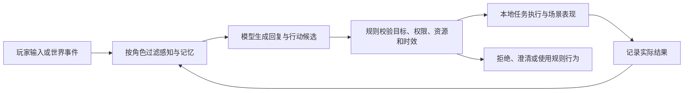

# AI NPC 小镇：初步策划大纲 v0.1

日期：2026 年 11 月 4 日  
定位：长期迭代项目的起始方案，供下一轮讨论与原型开发使用。

用户已确定的方向是「开发一个 AI NPC 系统，以小镇作为初步实现」。本文中的名称、角色、剧情、人数和阶段划分均为策划建议，尚未作为最终需求锁定。

## 1. 项目定位

**一句话概念：搭建一个居民有自己的生活、记忆和关系的小镇，让玩家通过交流与行动参与其中，并看到自己的选择如何影响居民和小镇。**

项目分成两个相互支撑的部分：

| 部分 | 目标 | 主要产物 |
| --- | --- | --- |
| AI NPC 系统 | 支持角色感知、记忆、交流、决策与行动，后续可用于其他场景 | 角色配置、事件记忆、动作接口、运行与调试工具 |
| 小镇体验 | 用具体的人物和生活事件检验系统是否可信、是否有趣 | 可探索地图、居民关系、小事件、玩家交互与结果反馈 |

建议以「生活模拟 + 社会互动 + 轻任务」为体验方向。玩家是新搬来的居民兼社区帮手，通过参与日常事务逐渐认识大家。前期主要满足探索人物、理解关系、尝试不同处理方式的乐趣；后期再决定是否增加经营、建设或更强的剧情主线。

首轮暂按 Unity、PC 单机、文字交流、俯视或斜俯视视角设计。先用灰盒和简单角色验证交互，再确定 2D 像素或低多边形 3D 的最终表现。模型通过可替换接口接入，选型另做小样本比较。

## 2. 希望玩家感受到什么

1. **居民有自己的生活。** 玩家不交谈时，他们也会去工作、休息或处理已有任务；受到打扰后能够继续原来的事情。
2. **居民记得共同经历。** 借过的工具、兑现的承诺、曾经的误会，能够影响之后的回应和协助意愿。
3. **居民各自掌握不同的信息。** 亲眼看到、听别人说、自己的猜测应有区别；新证据能够纠正旧判断。
4. **交流能带来实际变化。** 说服、告知、求助与约定可以改变任务安排、物品交接或关系，变化能够在场景里看到。
5. **玩家能理解后果。** NPC 的拒绝和改主意有可追溯的原因，玩家可以补充证据、换一种办法或接受代价。

以上体验是逐步建设的目标。首轮重点验证第 3、4、5 项，日程和关系只做支撑它们所需的最小实现。

## 3. 核心玩法循环

**发现小镇中的问题 → 观察和询问 → 判断信息与关系 → 选择帮助方式 → NPC 执行或拒绝 → 世界与记忆更新 → 遇到后续变化。**

玩家的主要操作包括移动、查看场景物品、与居民交谈、提供线索、提出请求、领取或交付物品。自由文字输入旁提供「询问近况」「询问事件」「出示线索」「请求帮助」等快捷入口，降低不知道该说什么的负担。

一次互动应有三层反馈：

| 时间尺度 | 玩家得到的反馈 | 示例 |
| --- | --- | --- |
| 当下 | NPC 理解了什么、是否愿意配合 | 「我可以去看看，但先告诉我你在哪里见到的。」 |
| 几分钟后 | NPC 行为或现场状态发生改变 | 木匠离开作坊取回工具，随后开始修缮 |
| 下一次互动 | 旧经历影响新选择 | 因为玩家上次兑现约定，木匠愿意再次借出工具 |

进展优先用新的协作机会、关系改善、公共设施恢复和人物经历体现。首版不需要完整等级、装备或货币成长系统。

## 4. 小镇与角色的初步构成

### 4.1 场景

首版一张紧凑地图，包含四个功能点：中央广场、木工作坊、杂货铺、公共雨棚。住宅入口只承担上下班与休息表现，暂不制作可探索室内。

广场提供公共目标，作坊提供工具与维修能力，杂货铺提供消息交流，雨棚提供可观察的事件线索。主要地点相距较近，让玩家容易看到居民行动与任务变化。

### 4.2 三名初始居民

| 居民 | 身份与倾向 | 日常行为 | 首个事件中的认知 | 玩家影响的切入点 |
| --- | --- | --- | --- | --- |
| 阿木 | 木匠，重视守约，说话直接 | 在作坊工作、到广场维修 | 知道工具借给了小川，尚不知道已归还到别处 | 出示线索、归还工具、兑现借用约定 |
| 阿禾 | 杂货店主，热心，习惯转告消息 | 看店、整理货物、与邻居交谈 | 见过小川拿走工具，不知道借用约定 | 帮助核实消息，决定是否继续传播 |
| 小川 | 跑腿青年，愿意帮忙，但安排容易混乱 | 送货、搬运、短暂休息 | 知道自己借用过工具，也知道归还地点 | 询问经过、协调时间、请求带路 |

性格需要影响有限的选择，例如是否要求证据、是否愿意借物、是否优先兑现约定；人物口吻只是其中一部分。人物的底线与重大关系变化由明确配置和事件规则约束。

后续可逐步扩展到 6—8 名居民，每新增一名都应带来独特的资源、关系或行动能力，避免只有姓名和说话风格不同。

## 5. 首个可玩事件：「集市前的工具失踪」

### 5.1 事件前提

小镇准备在傍晚举办集市，广场长凳需要修好。阿木找不到自己的锤子，维修暂时停下；阿禾提到自己曾看见小川拿走工具。

系统预设的真实经过是：小川得到阿木许可借用了锤子，归还时作坊无人，又遇上下雨，便把锤子放在公共雨棚的收纳箱里。阿木尚未收到通知，阿禾只看到了拿走的过程。

这些事实在本局开始时固定。模型根据各角色掌握的证据作出解释和行动建议，不能临时改变事件真相。

### 5.2 玩家如何推进

玩家可以先询问阿木了解借用约定，再找小川确认归还地点；也可以先听阿禾的说法，再去现场查证。抵达雨棚后，查看带有作坊标记的锤子，形成可出示的线索。

找到工具后，玩家可以亲自归还，也可以在小川愿意且有空时请他带回。工具真正交付后，阿木才能继续维修。若玩家将未经确认的说法转告别人，接收者会把它记为「某人转述」，再依据既有认知决定是否相信或核实。

首版传播限定在这起事件的有限命题内，例如「拿走」「借用」「已归还」「归还地点」。只在实际交谈或目击后改变角色认知；不把一次传言自动广播给全镇。

### 5.3 不同处理方式的结果

| 玩家处理方式 | 可见的任务结果 | 可见的关系后果 |
| --- | --- | --- |
| 核实经过，带回工具，并帮助当事人说明情况 | 长凳修好 | 误会解除，后续更愿意合作 |
| 只找回工具，没有澄清已经传播的说法 | 长凳可以修好 | 部分居民仍保留疑虑，下一次交流出现差异 |
| 传播未经核实的指责 | 调查可能更曲折，但仍可补救 | 被指责者降低协助意愿；提供证据和道歉可修复 |
| 没有及时解决 | 集市使用临时座位，事件仍能结束 | 居民记住未完成的约定，留下后续修复机会 |

结果由「工具是否归还、维修是否完成、哪些人获知了哪些证据、承诺是否兑现」等状态组合产生。对话围绕实际结果生成。玩家无需猜中一句特定台词才能通关。

### 5.4 展示节奏

目标体验长度先设为 15—20 分钟：进入小镇认识人物，发现问题，完成调查与交接，看到修缮和关系反馈，最后跳转到次日做一次简短回访。

首版对话期间暂停世界时钟，避免模型响应速度决定任务成败；非对话阶段按游戏时间推进。开发调试支持暂停、加速和重置。失败采用可补救结果，不让关键线索永久消失。

这个事件用来检验系统，并不意味着整个项目以后必须做推理游戏。后续可以换成送货、节日准备、邻里互助或资源分配，复用同一组 NPC 能力。

## 6. AI NPC 系统的能力大纲

| 模块 | 首版功能 | 后续扩展 |
| --- | --- | --- |
| 身份与性格 | 职业、稳定倾向、表达风格、明确底线 | 多重目标、价值观冲突 |
| 感知与知识边界 | 记录亲眼所见、对话所得和来源；隔离不同角色的知识 | 更多感知条件、隐私与保密约定 |
| 记忆 | 保存重要事件、借还记录和纠错关系 | 摘要、遗忘、长期经历检索 |
| 日程与需求 | 工作、休息、当前任务；受打扰后恢复 | 动态日程、更多生活需求 |
| 决策与行动 | 从合法动作中提出选择，执行成功后写入事件 | 条件任务、局部改计划、多人分工 |
| 社会关系 | 对玩家及关键 NPC 的信任、待履行承诺 | 关系传播、互惠、群体关系 |
| 对话 | 基于角色知识回答，理解有限询问、告知和请求 | 群聊、有限协商、语音 |
| 调试与存档 | 查看认知来源、当前任务、请求与结果；保存关键状态 | 固定响应回放、批量场景比较 |

三个数据层必须分开：**世界里确实发生的事、NPC 相信的事、NPC 说出来的话。** 例如，阿禾说「小川可能拿走了工具」，只会产生一条带来源的说法，不会改变物品位置，也不能自动判定小川偷窃。

首版优先按人物、事件、时间与来源做结构化查询。记忆量增加并出现明确检索问题后，再加入向量检索和更复杂的反思机制。

## 7. 系统与游戏规则如何分工

建议采用「模型提出高层意图，游戏程序校验并执行」的混合架构。

模型负责理解自然语言、组织角色表达，以及在可行候选中选择下一步。游戏程序负责物品归属、位置、时间、任务条件、关系数值、寻路和动画。

首版动作限制为移动、等待、交谈、查看、拾取、交付，以及绑定目标物的简单工作。借物请求先转成清晰条款：谁借、借什么、何时归还；双方确认后才成为待履行任务。

NPC 表达「愿意帮忙」时，界面显示已接受或待执行；只有实际动作成功，才显示已完成。目标消失、任务取消或新局开始后，旧模型回复不能继续生效。

日常移动和日程由本地规则维持。模型主要在玩家交流、关键事件或任务失败时调用，并限制并发、重试和上下文长度。模型不可用时保留基本交互和任务流程，用预设回复说明当前状态。

## 8. 界面与表现

玩家界面保持简洁，至少包含：

- 小镇场景与居民当前活动提示，让玩家知道谁在忙、谁在等待。
- 对话面板，提供文字输入、快捷话题，以及线索或物品的出示入口。
- 个人记事本，区分「亲自确认」和「听某人说」，帮助玩家整理信息。
- 任务与约定记录，明确对象、物品、进度和期限。
- 事件收尾，回顾完成了什么，以及哪些关系出现变化。

玩家看到的信息以自身经历为限。开发者另有调试面板，查看世界事实、角色认知来源、当前任务和执行日志；这部分不作为默认游戏界面。

长文本尽量拆为短回应，结合人物朝向、走动、等待图标与简单动作反馈，避免玩家需要持续读长篇聊天记录才能理解进展。

## 9. 第一版范围与演进顺序

### 9.1 首版范围

**3 名 NPC、4 个功能点、1 个完整事件、1 次次日回访、15—20 分钟体验。** 必须形成「交流 → 认知变化 → 行动 → 结果 → 记忆」的一条完整链路。

首轮暂缓：大规模人口、完整经营经济、自由建筑、战斗、多人联机、全天候云端模拟、语音、模型训练，以及自动生成任意任务的剧情导演。后续按试玩结果挑选最有价值的一项加入。

### 9.2 按里程碑推进

| 阶段 | 做出什么 | 进入下一阶段的依据 |
| --- | --- | --- |
| A：规则原型 | 灰盒小镇、三人日程、工具事件、物品交接与结果界面 | 不接模型也能完成、失败、补救和重置事件 |
| B：首次 AI 接入 | 角色化对话、询问和请求解析、有限动作执行 | 不同说法能触发正确能力；取消与迟到回复可控 |
| C：记忆与信息差 | 独立知识、消息来源、证据纠错、轻量信任反馈 | 未被告知者保持未知，获知者能据此改变行为 |
| D：可试玩版本 | 新手引导、等待反馈、存档、次日回访、故障降级 | 陌生试玩者能够理解目标和后果，完成整段体验 |
| E：验证可复用性 | 复用系统制作第二个事件，例如送货时间冲突 | 新内容主要通过角色、事件和规则配置完成 |
| F：扩大生活感 | 扩展居民、日程、协作或长期关系 | 新能力带来可辨认的玩法收益，调用成本可接受 |

各阶段先看验收结果，再估算工期。第二个事件尤其重要：它用来检验首个事件中的能力是否已经形成可复用系统。

## 10. 怎样判断方向值得继续

首轮研究问题建议收敛为：**角色拥有带来源的记忆后，玩家能否更清楚地理解并影响 NPC 的行为？**

对照可以设置为「固定规则与选项」「模型交流但只保留近期上下文」「模型交流并使用带来源的事件记忆」。比较两种模型方案时，保持模型、输入事件、动作集合及知识权限一致，仅改变记忆组织方式。所有方案都必须遵守角色的知识边界。

| 检查点 | 记录方法 | 希望证明什么 |
| --- | --- | --- |
| 知识边界 | 询问应该知道、尚未知道、已被纠正的问题，按次数记录错误 | NPC 的回答受经历约束 |
| 行动兑现 | 记录请求接受、实际执行、完成和失败的次数与原因 | 交流能够可靠地落到游戏动作 |
| 行为变化 | 从同一初始状态分别提供证据、隐瞒或传播说法 | 信息差改变选择，而非只有台词变化 |
| 玩家理解 | 试玩后询问「他为什么不帮你」「你怎样改变了结果」 | 后果对玩家是可理解的 |
| 体验代价 | 记录等待时间分布、重复输入次数、单局请求和用量 | 收益没有被等待与负担抵消 |
| 工程稳定性 | 测试取消、目标失效、读档、断网、重复回复和重开 | 失败可恢复，状态不被旧结果污染 |

关键防错用例要求零次越权改写世界状态、零次重复发放物品、零次旧局回复污染新局；其余成功率和耗时目标在拿到第一轮数据后确定。试玩可先邀请约 5 人发现问题，不据此推断大众留存或商业效果。

同一场景多次运行并保留失败结果。工程复现保存模型响应、状态版本和执行顺序；重新请求模型则作为新的能力实验，不声称只靠随机种子即可精确复现。

## 11. 参考案例与借鉴方式

以下案例按公开资料整理，检索日期为 2026 年 11 月 4 日。本次没有运行这些工程；公开展示和开源代码不等于已经验证适配当前 Unity 项目。

| 案例 | 公开内容与参考价值 | 本项目具体借鉴 | 使用边界 |
| --- | --- | --- | --- |
| Generative Agents / Smallville | 2023 年研究以 25 个智能体构建小镇，结合记忆、反思和计划，并展示信息传播与协调行为。[论文](https://arxiv.org/abs/2304.03442) | 角色经历进入记忆，再参与下一次选择的循环 | 属于研究原型；可信行为不直接等于有趣的玩家任务 |
| AI Town | 开源小镇框架，角色生活、交谈、社交；官方 v2 介绍允许玩家走动并与居民交流。[仓库](https://github.com/a16z-infra/ai-town)、[官方介绍](https://stack.convex.dev/ai-town-v2) | 地图与交流结合、居民自主互动、角色配置和状态可视化 | JS/TS 与 Convex 技术栈，不能直接当作 Unity 成品框架 |
| RimWorld | 官方介绍强调居民需求、背景、关系和事件驱动的故事体验。[官网](https://rimworldgame.com/) | 用日常行为、关系变化和事件后果制造生活感；让人物状态可读 | 作为玩法与系统设计参照，不能据此声称原版 NPC 由大语言模型驱动 |
| Ubisoft Teammates | 2025 年公开的可玩研究实验，玩家用自然语音指挥两名实体队友，触发回应与行动。[官方介绍](https://news.ubisoft.com/en-us/article/3mWlITIuWuu0MoVuR6o8ps/ubisoft-reveals-teammates-an-ai-experiment-to-change-the-game) | 让表达改变行动，并在设计好的世界与角色边界内即兴回应 | 体验案例；该介绍不提供可直接复用的完整实现 |

建议先看 AI Town 理解整体交互，再读 Generative Agents 理解记忆与计划，随后用 RimWorld 检查游戏反馈是否清晰，用 Teammates 检查语言是否真正进入行动链路。Generative Agents 的实现入口见[作者仓库](https://github.com/joonspk-research/generative_agents)。

原手册中的 [ECHO](https://www.xyxya.xyz/ideas/echo-unity-ai) 继续保留为已有讨论的工程参考，重点是记忆来源、协作和异步执行。此次页面未能重新读取，对其能力的理解仅沿用用户提供的手册，不视为当前实现已核验，也不假设已经取得完整工程。

## 12. 下一轮策划优先细化什么

建议依次补齐以下五份短规格，每份围绕首个事件写到可以实施即可：

1. **角色卡：** 三人的背景、倾向、初始认知、关系和可执行能力。
2. **事件状态图：** 固定真相、线索获取、物品归属、完成条件与补救路径。
3. **动作与请求表：** 支持哪些表达、参数是什么、何时拒绝或澄清、怎样取消。
4. **界面草图：** 玩家在哪里发现问题，如何出示证据，怎样看到 NPC 开始行动。
5. **第一轮验证表：** 三种对照方案、典型输入、失败用例和记录字段。

当前可暂定的项目研究名称为：**「面向小镇社会交互的 AI NPC 记忆与行为系统」**。体验名称可暂用「小镇日常」，待美术风格和玩家身份明确后再命名。

本稿主要承接用户提供的 [《AI NPC 与游戏玩法研究选题手册》](/Users/sanwuwei/Downloads/AI_NPC与游戏玩法研究选题手册.pdf) 第 4 页「记忆与信息差」、第 7 页「承诺与社会互动」、第 9—10 页「客户端基础与验证」。手册中的其他方向作为后续选项，不全部并入首版。
