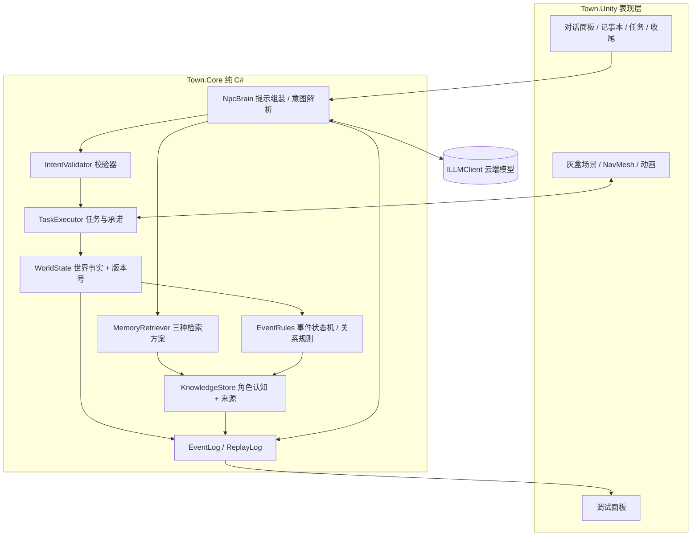
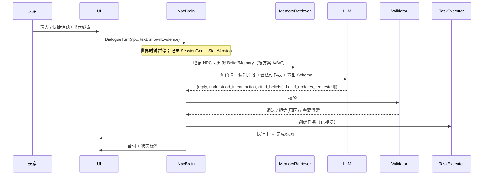

# AI NPC 小镇：实现大纲 v0.1

日期：2026-11-04　｜　对应：[策划大纲 v0.2](AI_NPC小镇_策划大纲_v0.2.md)

> 原则：**模型提出，程序裁决。** 世界事实、角色认知、角色台词三层分开存储；模型的任何输出在进入世界前都要经过校验。

---

## 1. 技术选型（本月）

| 项目 | 选择 | 理由 / 备注 |
| --- | --- | --- |
| 引擎 | Unity 6 LTS，3D 灰盒，俯视相机 | 手册要求 Unity 客户端优先；灰盒推迟美术决策 |
| 寻路 | NavMesh（AI Navigation 包） | 4 个地点、3 个角色，无需自写 |
| UI | UGUI（游戏内）+ IMGUI/UI Toolkit（调试面板） | 调试面板求快，不求好看 |
| 异步 | C# async/await（可选 UniTask） | 主线程采快照 → 后台等推理 → 回主线程校验执行 |
| 模型 | **云端 API**，通过 `ILLMClient` 接口接入；主模型 1 个 + 便宜模型 1 个 | 本月不碰本地模型（LLMUnity 放到下个月评估）；按公司合规要求选供应商 |
| 输出格式 | JSON Schema 结构化输出 / 工具调用 | 解析成功 ≠ 合法，后面还要业务校验 |
| 序列化 | Newtonsoft.Json | 存档、日志、用例、回放共用 |
| 配置 | ScriptableObject（角色卡、动作表、事件）+ JSON 导出 | 方便策划改，方便测试工具读 |
| 测试 | Unity Test Framework（EditMode）+ batchmode 跑批 | 核心逻辑放纯 C# 程序集，能脱离场景测试 |

**关键结构决定：** 把「世界规则 + 认知 + 大脑」写成**不依赖 UnityEngine 的纯 C# 程序集**（`Town.Core`），Unity 场景只是它的一种「表现层」。这样对照实验和回放可以在 batchmode 里无画面批量跑，是本月能按时出实验数据的关键。

---

## 2. 架构分层



### 程序集与目录

```
Assets/
  Town.Core/            # 纯 C#，asmdef 不引用 UnityEngine
    World/              # WorldState, Item, Location, Clock
    Knowledge/          # Proposition, Belief, Source, KnowledgeStore
    Memory/             # IMemoryRetriever + Recent / SourceAware 实现
    Brain/              # PromptBuilder, ILLMClient, IntentParser, Fallback
    Actions/            # ActionRegistry, ActionDef, IntentValidator
    Tasks/              # TaskExecutor, Commitment
    Rules/              # HammerEventRules, RelationshipRules
    Logging/            # EventLog, ReplayLog
  Town.Unity/           # MonoBehaviour 适配层、场景、UI
  Town.Tools/           # 调试面板、批量实验 Runner（Editor）
  Town.Tests/           # EditMode 测试
Config/
  characters/*.asset  actions.asset  events/hammer.asset
  testcases/*.json      # 验收用例集
```

---

## 3. 核心数据结构

```csharp
// —— 世界层：只有规则代码能写 ——
class WorldState {
  int Version;                 // 每次成功变更 +1
  int SessionGen;              // 每次新局/读档 +1
  GameTime Now;
  Dictionary<string, ItemState> Items;   // hammer: {location, holder, ownerTag}
  Dictionary<string, NpcState> Npcs;     // 位置、当前任务、忙碌状态
  EventFlags Flags;                      // 长凳进度、集市是否开始…
}

// —— 认知层：每个 NPC 一份 ——
enum SourceType { Experienced, Witnessed, ToldBy, Inferred, SawEvidence }
class Belief {
  string Id; string NpcId;
  string PropositionId;        // P1..P6
  bool   Stance;               // 相信为真 / 相信为假
  float  Confidence;           // 0..1，规则给定，不由模型给
  SourceType Source; string SourceNpcId; string EvidenceId;
  GameTime LearnedAt;
  string SupersededBy;         // 被新证据纠正时指向新 Belief
}

// —— 记忆：对话与事件的情景记录（用于检索） ——
class MemoryEntry { string Id, NpcId, Kind; string Summary; string[] PropositionIds; string[] Participants; GameTime At; }

// —— 关系与承诺 ——
class Relationship { string From, To; int Level; /* -1 戒备 0 普通 1 信任 */ List<string> ReasonLog; }
class Commitment { string Id, Debtor, Creditor, ItemId; GameTime Deadline; CommitState State; int CreatedAtVersion; }

// —— 模型请求信封：防旧回复 ——
class LlmRequest { string RequestId; int SessionGen; int StateVersion; string NpcId; ... }
```

**三层隔离的硬约束：**
- `KnowledgeStore` 只能通过「感知事件」和「对话事件」写入，写入时必须带来源。
- `PromptBuilder` 只能读该 NPC 的 Belief 与 Memory，**拿不到 WorldState 的事实表**（编译期隔离：Brain 程序集不引用 World 的真值接口，只拿一个 `NpcPerceptionView`）。
- 台词（模型输出的 text）只进入日志和 UI，不回写任何状态。

---

## 4. 一次对话回合的流程



### 模型输出 Schema（草案）

```json
{
  "reply": "string，1-3 句",
  "understood": { "intent": "ask|tell|show_evidence|request_help|small_talk|unclear", "proposition": "P1..P6|null" },
  "action": { "id": "none|move_to|give_item|fetch_item|start_repair|guide_player|wait", "args": {} },
  "cited_beliefs": ["belief id，回答依据"],
  "attitude_hint": "cooperative|hesitant|refuse",
  "refuse_reason": "string|null"
}
```

### 校验器检查项（全部规则代码，0 容忍项标 ★）

1. ★ `SessionGen`/`StateVersion` 过期 → 丢弃（旧局回复污染 = 0）
2. ★ 动作必须在 `ActionRegistry` 中，参数目标存在、可达、角色有能力
3. ★ 物品转移只由 Executor 按当前 WorldState 执行，同一 RequestId 幂等（重复发放 = 0）
4. ★ `cited_beliefs` 必须全部属于该 NPC 且未被纠正；引用不存在的 → 判「越权/幻觉」，回复替换为兜底台词并记日志
5. 关系档位不满足（如戒备时请求帮忙）→ 改为拒绝，并把规则原因交给 UI
6. 玩家「告知」的命题 → 由**规则**生成 `ToldBy(player)` Belief，模型只能「请求」更新，不能直接写
7. 超时（建议 8 秒）→ 兜底台词 + 不执行动作

**台词越权的二次检查（本月必须做）：** 对回复文本跑一个关键词/命题检测（如 NPC 不知道 P4 时回复里出现「雨棚」「收纳箱」），命中即记为越权披露。这是实验的主指标之一，先用规则词表，够用。

---

## 5. 信息传播规则

- **触发：** 只有「实际对话」或「目击」才写入认知，不做全镇广播。
- **NPC 之间传播（本月最小版）：** 阿禾在午后送货经过广场时，与在场者有一次「闲聊」，按规则转述她当前相信且把握 ≥ 0.5 的命题（包括玩家告诉她的 P5）。闲聊内容用模板生成，不调模型，保证可复现。
- **纠错：** 收到 `SawEvidence` 或亲历者证词时，冲突的旧 Belief 置 `SupersededBy`，保留历史供调试面板展示「为什么改主意」。
- **去重：** 同一命题追溯到同一原始来源的转述，计为一份证据。

---

## 6. 三种对照方案（实验自变量）

| 方案 | 对话方式 | 记忆 | 说明 |
| --- | --- | --- | --- |
| A 规则基线 | 快捷话题菜单 + 模板台词 | 结构化 Belief，规则选回复 | 不调模型；也是模型故障时的降级路径 |
| B 模型 + 近期上下文 | 自由文本 | 该 NPC 最近 N 条对话 + 按时间排列的可知事件，截断到固定 token 预算 | 同样遵守知识边界，只是不按来源/相关性组织 |
| C 模型 + 来源记忆 | 自由文本 | 按命题相关性 + 来源可信度 + 时间筛选 Belief/Memory，标注来源和是否已纠正 | 本研究的主方案 |

公平性：B、C 使用同一模型、同一动作表、同一 token 预算、同一用例集，只换 `IMemoryRetriever` 实现。

---

## 7. 调试、日志与回放

- **调试面板（F1 开关）：** 世界事实表｜选中 NPC 的 Belief 列表（来源、时间、是否被纠正）｜当前任务与承诺｜关系档位及变化原因｜最近 20 次模型请求（提示、原始输出、校验结果、耗时）。
- **ReplayLog：** 每个模型请求保存 `RequestId / SessionGen / StateVersion / 完整提示 / 原始响应 / 校验结果 / 执行结果`。回放模式下 `ILLMClient` 换成 `RecordedLLMClient`，按 RequestId 返回录制响应，用于验证「同一响应 → 同一执行结果」。
- **控制：** 暂停 / 1x / 4x / 重置本局 / 读写快照。

---

## 8. 评估工具与用例集

- **用例格式（JSON）：** 初始快照 + 玩家输入序列 + 期望（应知/应不知/应拒绝/应执行的动作/禁止出现的词）。
- **用例规模（本月目标）：** 约 40 条
  - 知识边界 15 条：应该知道 / 尚未知道 / 知道过但已纠正
  - 行动兑现 10 条：同义不同说法、含糊需澄清、关系不足应拒绝
  - 传播与纠错 8 条：转述、重复转述去重、出示证据改判
  - 工程反例 7 条：取消、目标消失、读档后旧回包、重复请求、超时、断网、重开
- **跑批：** batchmode 命令行，每条用例 × 每方案 × 重复 5 次（模型有随机性），输出 CSV。
- **指标：** 越权披露率、过时信息采用率、证据纠错率、行动落地率（答应→执行→完成）、澄清次数、P50/P95 响应耗时、单局 token 用量、0 容忍项计数。
- **试玩记录：** 录屏 + 问卷 4 问（是否理解了我 / 是否影响了结果 / 等待是否打断体验 / 是否愿意再玩）+ 两个解释题。

---

## 9. 成本与调用控制

- 只在**玩家发起对话**时调用模型；NPC 日程、NPC 间闲聊、移动全部是规则。
- 单 NPC 并发上限 1；新请求到来时旧请求标记过期。
- 提示组成估算：角色卡 ~400 tokens + 认知片段 ≤ 800 + 动作表 ~300 + 最近对话 ≤ 600 → 单次输入约 2k tokens。单局约 30—60 次调用。跑批前先用小样本估算总费用并确认预算。

---

## 10. 技术风险与预案

| 风险 | 表现 | 预案 |
| --- | --- | --- |
| 模型泄露不该知道的信息 | 阿禾直接说出锤子在雨棚 | 提示中物理上不含该信息 + 引用校验 + 词表检查；仍发生则算实验数据，不掩盖 |
| 意图解析不稳 | 同一句话时而请求时而闲聊 | 快捷话题兜底；低把握时让 NPC 反问澄清；用例集回归 |
| 延迟影响体验 | 每轮 3—8 秒 | 对话时世界暂停；先显示「思考中」与朝向动画；流式显示台词（可选） |
| 异步状态竞争 | 玩家走开/重开后旧回复执行 | 信封版本号校验，W2 就做，不拖到后面 |
| 纯 C# 核心与 Unity 双写 | 表现层私自改状态 | 规定 MonoBehaviour 只能调用 Core 的命令接口；代码评审检查 |
| 模型服务不可用 | 接口故障或额度用完 | 方案 A 即降级路径；录制响应可演示 |
| 工期 | 一人一月偏紧 | 见排期文档的砍需求顺序 |
