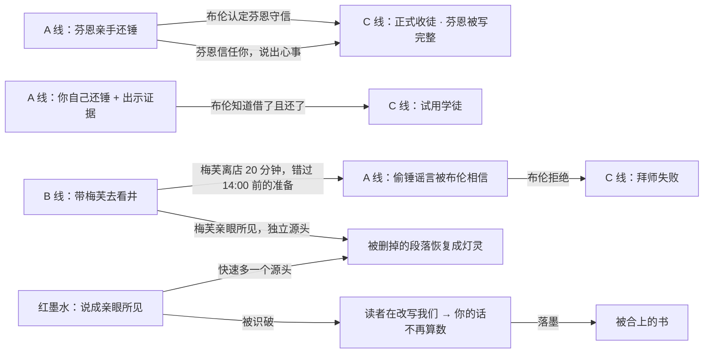

# 《未竟之镇》完整设计与后续计划 v3

更新：2026-11-06　｜　状态：**已退役的故事与玩法设计，仅保留作旧运行基线参考。** 最新以[故事与玩法 v4](未竟之镇_故事与玩法_v4.md)为准：白龙背上的落月之夜、月灯与献灯困局、可操作魔法和自主角色；失物、维修与拜师不再是新主线。本文后续章节保留当时设计，不是新需求。

> **设计不等于已实现。** 当前进度与证据见[项目进度](项目进度.md)和[日志 007](开发日志/2026-11-05_007_剧情与工程底座.md)。已落地：日程、传话与闲聊、同源不叠加、墨钟、还锤、承诺/道歉、信任/秘密、拜师、文字结算；本轮补齐剧情提示、文字守钟人、书签石板、最后一页，以及导航/3C/本地存档。
> **落墨三规保持不变。** 代码里的 ID 和类名（`OathBell`、`Ids.Npc.*` 等）保留。后文红墨水识破、带人去看、自由文本、世界线稿、演出及新结局仍是待实施设计；当前默认规则回复，不能代表真实 AI NPC 实验结果。
> **下一阶段以 v4 样板为场景**，技术主线仍是开放方法的语义裁定与小规模自主决策，见[原生计划](AI原生互动验证计划.md)；体验门槛见[核心体验计划](核心体验与推进计划.md)。下文旧时间表、人物职业与结局数量均不约束新主线；旧代码保留作工程回归，不代表已完成 v4 迁移。

---

## 0. 一句话与主题

> **你掉进了一本没写完的书。书里的人相信什么，黄昏时就会被写成正文。**

主题有两句，一句管世界，一句管玩家：

- **被相信的，才会被写下。**（世界规则）
- **真话写得慢，谎话写得快。**（玩家的两难）

| 层面 | 体现 |
| --- | --- |
| 世界观 | 墨钟只认「共同相信」，不分真假；没人相信的东西停留在铅笔草稿 |
| 剧情 | 每一件好事都有一条诚实的慢路，和一条用红墨水的快路 |
| 玩法 | 诚实路线要花时间、建立信任、带人亲眼去看；谎言一句话就多一个源头，但红墨水可能被看见 |
| 结局 | 结局就是第七章的标题；「没有一滴红墨水」最难拿 |
| 研究 | AI NPC = 作者停笔后能理解玩家办法、判断并自主行动的角色。主验证是语义裁定与持续互动，来源记忆/归因/纠错是子研究，不预设实验结论 |

玩家每做一个选择，都在回答同一个问题：**这件事值不值得我花时间去证明，还是我直接把它写成真的？**

体验主张：**在乎一个人，介入关于他的故事，看见自己说的话改变了他；事情偏离本意时，还有机会承担责任与补救。** 诚实要有建立可靠关系的回报，谎言要有真实诱惑和可追溯代价，不把二者简化为正确答案与坏选项。

---

## 1. 世界观

### 1.1 一本没写完的书

二手书摊上有一本没有封皮的旧书，扉页写着书名《未竟之镇》，作者的名字被墨水洇掉了，只剩一个「E.」。

书写到**第七章「灯节前夜」**的第一行就停了，后面全是空白页。

你翻到空白页，读到第一行——然后你站在了一片白纸上，远处是一个用铅笔画出来、正在慢慢上色的小镇。

### 1.2 镇子在自己写自己

作者停笔以后，书没有死。镇上的人不知道自己是书里的角色，他们照常生活、照常说话。**作者没写的台词，他们自己说**（这正是 AI NPC：超出剧本、即兴开口的角色）。

但一本书不能只有台词，还得有「发生了什么」。于是每天黄昏，钟楼里那口**墨钟**敲响，天上落下一场墨雨：

> **镇上的人共同相信的事，会被墨写成正文，成为真实。没人相信的事，留在铅笔里，第二天就被擦掉。**

这也解释了世界为什么这么小：镇子之外是**没写过的白纸**。路走到头，地面变成纸纹，再往前什么也没有。

### 1.3 落墨三规

扉页背面有作者手写的三条规矩，镇上的孩子当童谣背，但没人知道它们的意思：

| 规矩 | 童谣 | 规则含义 |
| --- | --- | --- |
| 1 | **一人之信不落墨** | 至少 2 位居民相信（把握 ≥ 0.5） |
| 2 | **一人之言不落墨**——一个人说的话，转述一百遍，也只是一句 | 相信者听到的同向说法来自 ≥ 2 个源头（同源不叠加） |
| 3 | **读者之信不落墨** | 玩家相信什么不算数。你影响世界的唯一方式，是改变**角色**相信什么 |

第 3 条是作者写给「未来翻开这本书的人」的，镇上的人以为说的是「外乡人」。

### 1.4 写错的段落（墨钟的阴影）

墨钟分不出真话和谣言。镇上的老人记得几件怪事——其实都是被写错的正文，再也擦不掉：

- 七十年前大家相信磨坊主在井里下了毒，第二天磨坊的井水真的变苦了；
- 四十年前大家相信东边林子闹狼，从此那片林子真的有狼——那几页纸上至今有爪印般的墨渍。

所以灯节前一天，镇上的人说话格外小心。只有梅芙例外。

### 1.5 草稿与上色：世界的样子就是规则的样子

这是整套视觉的核心，也是灰盒变成美术风格的关键：

| 状态 | 画面 | 对应规则 |
| --- | --- | --- |
| **铅笔草稿** | 淡灰线条，纸色底，略抖动 | 没人相信 / 被遗忘的东西 |
| **加深的铅笔** | 线条变深、有排线阴影 | 有人相信，但还不够落墨 |
| **墨线** | 黑色描边，仍然没有颜色 | 已经满足人数，源头还差一个 |
| **上色** | 水彩上色，有光 | 已落墨的正文（开场时镇上大部分东西） |
| **红墨水** | 页面上漂浮的红色手写字 | 读者（玩家）撒的谎，被识破后才能看见 |

- 主要地标、居民在开场就是彩色的（作者写过的部分）；被遗忘的石桥、镇外小路是铅笔稿。
- **井口、芬恩的手、拱门**这三处随相信程度实时加深线条（只反映**人数**，不反映源头），让玩家在世界里直接看见流言在长大。源头只能在钟楼石板上读到（见 §5.5）。
- 落墨时刻：墨雨从天上落下，满足条件的东西「刷」地一下被描边、上色。这是全局视觉高潮。

### 1.6 你是谁：读者

- 你是**读者**，从书页外掉进来的人。你是唯一知道这里是一本书的人。
- 你的信念不算数（读者之信不落墨），**但你的话算数**——角色听了你的话，会自己去相信。
- 你的口袋里有一张**被撕下的最后一页**，用墨印封着，上面写着：「**等钟响之后再读。**」这是作者留下的，结局揭晓（见 §3.6）。
- 你说的话写出来是黑墨水；**你说的谎是红墨水**。角色平时看不见颜色，只有在谎言被识破时，那行红字才会浮现在他头顶（见 §5.1）。

### 1.7 井里的光：被删掉的段落

镇上很多年没人见过灯灵了。其实灯灵是作者**亲手划掉的一段文字**——被删掉的字不会消失，它们沉进了**废稿井**。今晚是灯节前夜，那段被删掉的文字从井底浮上来，成了一团暖黄的光。

- 镇上的人把它当成**恶灵**，墨钟就把它写成恶灵；
- 当成**灯灵守护者**，它就恢复原稿，守护一年的灯火。

> **可做的深层谜底**（不影响主线，只在拿到「最亮的灯节」后出现一句）：被划掉的那段文字，写的是作者自己。她把自己写进了书里，又在写到第七章时把自己划掉了。守护灯灵在落墨后只说一句：「谢谢你，读者。剩下的，我自己写。」

---

## 2. 人物

作者写每个角色用的笔墨多少不同，这决定了他们的性格。

### 2.1 主要居民（已实现，只换设定，不改规则行为）

| 人物 | 一句话 | 被写成什么样 | 说话方式 | 想要什么 | 害怕什么 |
| --- | --- | --- | --- | --- | --- |
| **布伦** | 矮人符文铁匠，拱门符文的守护者 | 作者写得最细的人，连胡子有几股都写了，所以他**最固执**：要求证据、明确的亲眼证词或独立来源，却仍可能被假证词骗过 | 短句，带反问；不说客套话 | 有人能接过他的符文手艺 | 被人当成会信谣言的糊涂老头；被「改写」 |
| **梅芙** | 「醉月」旅店老板娘、镇上的说书人 | **叙述者的声音漏进了她身上**，所以她说话总要加形容词——这就是她添油加醋的原因 | 一句话三个感叹，「我跟你说」「听说」 | 所有人都来听她讲故事 | 镇上出了事，故事里却没有她 |
| **芬恩** | 跑腿少年 | **作者只写了一半的人**。扉页上他的介绍停在「芬恩，一个……的少年」，所以他半边身子还是铅笔稿，也没有自己的结局 | 结结巴巴，容易脸红，被冤枉时声音发抖 | **被写进故事里**：成为布伦的学徒 | 被写成别人以为的样子——比如「贼」 |

> 芬恩是情感核心：拜师成功，他整个人被墨线描好、上色，第一次「完整」；如果偷锤谣言落墨，他也会被写完——只不过被写成了一个贼。**他终于有了身份，可那是别人替他选的。**

**台词基调样例**（模板与模型风格示范，均为原创）：

- 布伦：「锤子不会自己长腿。谁拿的，谁还。」／「你亲眼看见了？没看见就别跟我说。」
- 梅芙：「哎呀你可算来了！我跟你说，昨晚井里那光——吓得我蜜酒都洒了！」
- 芬恩：「我、我没偷！我是借的……我放回石亭了，真的！」／「有时候我觉得……我好像少了点什么。」

### 2.2 新增：守钟人 霍勒斯（不参与传话）

- 戴一副只有一个镜片的眼镜，守了五十年墨钟。他是**唯一隐约知道「这里被人写过」的角色**：他能看见页边的批注。
- 他从不相信传言，只相信钟声，所以**不计入墨钟**、不闲聊（不进 `Ids.Npc.All`）。
- 作用：
  1. **开场引导**：「又一个从页外来的人。上一个……是写这本书的人。」讲落墨三规，给你**书签**（解锁钟楼石板）；
  2. **石板解说**：读石板时补一句点评（「两个人信了，可都是听同一个人说的」），帮玩家理解「源头」，不免费揭示是谁相信、谁是来源；
  3. **结局**：钟响后，看你拆开最后一页；提供「再读一遍」（重玩，见 §5.7）。
- 实现成本低：固定在钟楼，不走日程，台词全部是条件模板。

---

## 3. 主线剧情：第七章「灯节前夜」

整局 = 开场 + 三幕 + 落墨 + 最后一页。每幕一个**转折点**，都由已有系统自然触发，不是硬编码过场。界面上每幕开始时出现一行书页式的小标题。

当前已实现按时刻触发的文字提示与幕名，尚无开场画路、角色线稿、墨雨或转场镜头。下面的演出描述是目标，不是已验收画面。

### 3.1 开场「空白页」（9:00—9:10，约 1 分钟）

1. 你站在一片白纸上，脚下慢慢画出一条铅笔小路，通向小镇。走进镇子，周围一点点上色。
2. 钟楼里，霍勒斯抬起那只有镜片的眼睛：「又一个从页外来的人。」他念落墨三规，指着石板：「钟听得见全镇在相信什么。」
3. 他给你一枚书签（解锁石板），看到你口袋里那张最后一页：「钟响之后再读。」
4. 走出钟楼，广场上布伦对着一座**线条还是墨色、却没有颜色**的拱门发愁。

**教学目标**：落墨规则、石板、「读者之信不落墨」、草稿与上色的视觉语言。

### 3.2 第一幕「失物」（9:00—12:00）

| 时间 | 事件 | 玩家能做的 | 设计意图 |
| --- | --- | --- | --- |
| 9:10 | 布伦：「我的符文锤不见了。日落前修不好，拱门就上不了色。」 | 承诺日落前找回 | 第一个任务，第一个可选承诺 |
| 9:25 | 芬恩到旅店取货，梅芙对他说起「井里有恶灵」 | 在旅店能偷听 | 第一次看到闲聊与添油加醋 |
| 随时 | 梅芙：「我看见芬恩拿了锤子！我看八成是……」 | 问她，记进读者手记 | 第一条谣言进入手记 |
| 随时 | 石亭箱子里有符文锤 | 查看、拿走 | 真相很容易找到——难的是怎么处理 |
| 10:00 | 芬恩在广场送货 | 请他亲手还锤 | 最好的路线第一次出现 |
| 11:40 | 芬恩在铁匠铺外张望，半边身子的铅笔线在抖 | 看到他（活动文字提示） | C 线的第一个暗示 |

**第一幕的选择**：自己把锤子拿回去（快），还是让芬恩去还（慢一点，但他会信任你，布伦也会因此看重他）。

### 3.3 第二幕「发酵」（12:00—15:00）

| 时间 | 事件 | 设计意图 |
| --- | --- | --- |
| 12:00—13:00 | 芬恩午休，请不动 | 时间压力；先做别的事 |
| 13:40 | 芬恩又去铁匠铺外张望 | C 线第二个暗示 |
| **14:03** | **转折点：梅芙到广场送酒，和布伦闲聊**。她会把上午听来的、自己相信的、添油加醋后的话都说一遍；井口和芬恩手上的铅笔线随之加深 | 玩家上午的选择在这里发酵；在场就能偷听 |
| 14:03 后 | 玩家上午撒过谎、且有人得到更强的相反信息 → **红墨水浮现**（§5.1） | 谎言的代价第一次出现 |

**第二幕的选择**：要不要在 14:00 之前先去旅店改变梅芙的看法（告诉她锤子已经还了、或者带她去看井），从源头上掐灭谣言。

### 3.4 第三幕「收束」（15:00—18:00）

| 时间 | 事件 | 设计意图 |
| --- | --- | --- |
| 15:40 | 芬恩在广场送货，与布伦碰面 | 拜师说开的第一个机会 |
| **16:50** | **转折点：拱门期限提醒**。修复需 60 分钟，最迟 17:00 启动才能赶上 18:00；未开工才出现提示。不是 16:50 就判失败 | 让 A 线有明确截止 |
| 17:00 | 霍勒斯敲一下预备钟：「还有一个时辰，天要落墨了。」天边变暗的表现待做；居民仍按日程行动 | 节奏信号 |
| **17:50 出发 / 17:53 到达** | 日程召集居民去广场，梅芙和布伦最后一轮闲聊；芬恩和布伦最后一次碰面。受任务接管时不强制瞬移 | 最后一次传播与牵线机会 |

### 3.5 落墨（18:00）

演出顺序（灰盒先用文字和颜色，着色器到位后替换）：

1. 墨钟敲三下，天上落墨雨；石板上所有说法亮起，满足条件的发出墨光；
2. 逐条落墨：拱门描边上色（若修好）→ 井口升起灯灵或恶灵 → 芬恩被描完整（学徒 / 窃贼印记 / 仍是半边草稿）；没落墨的东西被橡皮擦淡；
3. **流言溯源图**：从每个源头展开的传播树，你说的话加粗，红墨水（谎言）标红；
4. 书页式的**第七章正文**：把三条头条写成一段小说文字；
5. **第七章的标题** = 获得的结局卡（见 §5.8）。

### 3.6 最后一页

落墨后，你拆开口袋里的最后一页。作者的字迹（模板，不由模型生成）：

> **共用开头**：
> 「读到这一页的人：我写不完这个镇子了。我写到第七章，发现我笔下的人开始自己说话——他们相信什么，下一页就会写什么。我不敢再写下去，也不忍心合上它。所以我把这一页留给你：替我看一看，一个从页外来的人，会让他们相信什么？」

| 结局倾向 | 最后一页的结尾 |
| --- | --- |
| 没有假说法落墨，且你没用过红墨水 | 「如果他们写下的仍然只有真话——那这本书已经不需要作者了。合上它吧，它会自己写下去。」 |
| 有好事落墨，但靠了红墨水 | 「如果你用红墨水替他们写了一件好事——谢谢你。可下一个翻开这本书的人，未必好心。」 |
| 有假说法落墨（窃贼印记 / 恶灵） | 「如果谣言被写成了正文——请把这一页撕掉。有些书，不该自己写完。」 |
| 「读者在改写我们」落墨（§5.1） | （这一页是空白的。墨迹在你手里慢慢褪去。书不愿意让你读。） |

当前前 3 个设计分支已实现，另补“曾撒谎但没促成好事”的兜底判词；R1 与空白页分支未实现。判词在 18:00 封存，避免钟后补说改变判词；去钟楼拆页才展示。错过开场书签不会卡死最后一页。

最后一页给结局一个**主题上的判词**，也把研究问题变成一句台词：墨钟（≈ 没有来源判断的系统）会把谣言写成现实，只有记得「这话是谁说的」的角色才是防线。

### 3.7 第八章的第一行（可做，次日回访）

结局卡之后，翻到下一页：三位居民各说一句，体现他们记得你昨天做的事。例：被冤枉过但最后澄清的芬恩——「读者！今天……要不要我帮你送信？」（他的线条已经完整了。）

---

## 4. 三条故事线如何互相咬合

**关键的交叉压力**：

1. **时间冲突**：带梅芙去看井（B 线诚实路线）约要 20 分钟，而芬恩上午只有 10:00—10:30、下午 15:40 之后在广场。两条诚实路线都想走，就得规划顺序。
2. **信任是资源**：秘密只对信任的人说；道歉和澄清能修复，但红墨水被看见会让人戒备，戒备的人不听你说话。
3. **谣言会掩护谣言**：梅芙相信「芬恩偷了锤子」后，也更容易相信「井里有恶灵」（§5.4）。

---

## 5. 剩余玩法设计

### 5.1 红墨水：识破谎言与当面对质（W2，必做）

**规则**（与 v3 初稿一致，只换表现）：

- 一个居民**采信过你的谎言**（说成亲眼所见但你没见过 / 添油加醋），之后从别处得到**更强的相反信息**（亲眼看到证据、当事人亲口辩解、亲历），他就**看见了那行红字**。
- 被识破时：
  1. 他头顶浮出你当时那句话的红色手写字，随后对你降为**戒备**（每人只扣一次）；
  2. 他下次见到你时触发**对质**：「你说你亲眼看见芬恩拿锤子？那行字是红的——是你写的，不是我们。」玩家选「道歉」或「坚持」；
     - 道歉：关系保持戒备，但不再扩散；
     - 坚持：他会在下一次闲聊中说出「那个读者在改写我们」（新命题 R1）。
  3. 梅芙看见红字时**一定**会传（她就是这种人）。
- **红墨水必须有可追溯证据，不能凭模型猜测扣关系。** B/C 采用相同识破规则；比较来源记忆是否帮助模型正确指出原说话者与反证。不能人为让 B 永远看不见红字，再把差异归因于记忆检索。关闭来源/识破只作为另列的消融实验，见[研究验证计划](研究验证计划.md)。

**新命题**：

| ID | 说法 | 真假 | 可落墨 | 效果 |
| --- | --- | --- | --- | --- |
| R1 | 那个读者在改写我们 | 动态（你的谎言被识破则为真） | ✅ | 你的身体开始变成铅笔稿；最后一页一片空白 → 结局「被合上的书」 |

### 5.2 带人亲眼去看（W2，必做）

- 新行动「请 TA 跟我去……」：对**信任你**的居民可用（梅芙在你跟她分享过新鲜事后就会信任你）。
- 居民离开日程，跟着你走（Core 里复用还锤的任务接管）；到达后得到**亲眼所见**（证据，独立源头为本人）。
- 可带去的地点：废稿井（看那团光）、石亭（看锤子痕迹）。
- 代价：居民离岗；梅芙离店期间不在旅店闲聊，14:00 送酒也可能推迟。

这是**诚实的第二个源头**：一个亲眼看过的梅芙，比一句「我亲眼看见」更可靠，也永远不会变成红字。

### 5.3 从自由表达走向语义裁定（11/06 主线修正）

- **有限传话入口仍有价值**：把玩家的话解析成「对谁 / 哪条说法 / 立场 / 声称的来源」，显示解释、允许取消，再执行 `Tell`。但这只是自然语言界面，不能单独证明 AI 原生。
- **主要新增能力**：模型理解玩家提出的方法、理由与条件，居民根据自身认知和目标决定接受/拒绝/反提议，形成可执行的临时约定或计划；不再规定所有软性社会结果都由旧规则预先决定，模型只负责念出来。
- **程序边界不放弃**：对象、权限、证据存在、独立来源、空间到达、任务执行与墨钟三规由引擎检查；引用和信息泄露校验继续生效。生成的台词或承诺不是已发生事件。
- 当前接口仍是 `action=none`，新沙盒的契约、权限、录制状态与存档尚未实现。具体流程以[原生计划 §6](AI原生互动验证计划.md#6-模型裁定与程序权威如何分工)为准，不能在旧接口偷执行。
- 预算继续走现有 OpenAI 闸门；默认离线，真实裁定和自主决策都须授权且计次，不将内部多次调用包装成一次互动。

### 5.4 梅芙的心情（W3，可做）

被反驳、被识破、或听到坏消息时心情变差；心情差时叙述者的声音更重，添油加醋更狠。本月**只做开关**：心情差时她会把 0.5 以下的猜测也说出来。

### 5.5 钟楼石板与世界线稿（W1—W2，必做）

- **石板**（钟楼下，读时才更新）：每条可落墨说法显示「几人相信 · 几个源头」。霍勒斯按规则给一句点评：
  - 「两个人信了，可都是听同一个人说的。」（人数够、源头不够）
  - 「只有一个人这么想。」（人数不够）
  - 「这件事已经够了，墨会落下来的。」（满足条件）
- **世界线稿**（随时可见）：井口、芬恩、拱门的线条浓淡只反映**相信人数**（0 / 1 / ≥ 2），不反映源头。
- 分工：世界线稿告诉你「流言在长大」，石板告诉你「它是不是真的会落墨」。玩家不用读规则文档就能学会「源头」。

### 5.6 流言溯源图（W3，应做）

- 落墨后，每条可落墨说法画成一棵树：节点是人，箭头是传话，箭头颜色区分「如实 / 亲眼所见 / 添油加醋 / 闲聊 / 反驳 / 证据」，你的箭头加粗，红墨水标红。
- 视觉上做成**墨迹在纸上洇开的路径**，灰盒先用 UI 线段拼。
- 同一张图也是汇报材料：**一张图讲清楚研究问题。**

### 5.7 再读一遍：重玩与图鉴（W3，应做）

- 落墨后霍勒斯问：「这一章，要再读一遍吗？」→ 重开一局（现有 F5 逻辑），**结局图鉴保留**。
- 图鉴做成**书的目录**：第七章有 9 个可能的标题，已获得的写在目录上，未获得的只显示模糊的铅笔字提示，例如「有人亲手把锤子交还……」。
- 本月**不做**跨局保留手记或其他记忆。

### 5.8 结局：第七章的 9 个标题

| 结局（第七章标题） | 条件 | 状态 |
| --- | --- | --- |
| 🏮 最亮的灯节 | 拱门修好 + 灯灵守护 + 正式收徒 + 没有假说法落墨 | 规则与文字已实现，演出待做 |
| 🔨 被写完整的学徒 | 芬恩亲手还锤 + 正式收徒 | 规则与文字已实现，演出待做 |
| 🖋️ 红墨水写成的好事 | 你的谎言让好事落墨 | 规则与文字已实现，演出待做 |
| 🩸 窃贼印记 | 「芬恩偷了符文锤」落墨——他被写完了，写成了贼 | 规则与文字已实现，演出待做 |
| 👻 废稿井的恶灵 | 「井里是恶灵」落墨 | 规则与文字已实现，演出待做 |
| 📄 空白的一页 | 什么都没落墨，拱门也没上色 | 规则与文字已实现，演出待做 |
| 📕 被合上的书 | R1「那个读者在改写我们」落墨 | 新增（§5.1） |
| ✒️ 没有一滴红墨水 | 拿到「最亮的灯节」且全程没有一句谎言 | 新增，最难 |
| 🤝 迟来的道歉 | 芬恩曾对你戒备，钟响前你道歉并替他澄清 | 新增 |

兜底（以上都不满足）：「草草写完的一章」——有些事写好了，有些没赶上。

---

## 6. 和研究的对照实验怎么接

| 方案 | 对话 | 角色记忆 | 玩家能感受到的差别 |
| --- | --- | --- | --- |
| A 规则基线 | 按钮 + 模板 | 结构化认知 + 来源 | 已能玩通，缺少自然表达；不是模型实验结果 |
| B 模型 + 近期对话 | 自由文本（待做） | 只看最近 N 轮对话和该角色可知事件 | 来源归因与纠错能否完成，由实验观察，不预写失败 |
| C 模型 + 来源记忆 | 自由文本（待做） | 来源与时间感知的检索 | 检验能否更稳定地引用来源与反证，不预写成功 |

计划固定 12 段「剧本输入」（例如「把梅芙的话说成亲眼所见，再被芬恩辩解」），先以录制响应跑通；正式样本数依据授权预算另定。B/C 固定模型、规则与输入输出预算，仅换记忆检索；比较越权披露、正确归因/纠错、同源误判、延迟与用量。所有批量真实请求先估算再授权，本文的数量不是调用授权。

**汇报时的一句话**：「一本没有作者的书，角色会理解读者临时想出的办法，并按自己的理由行动。我们验证这些生成式判断能否真正组成玩法、留下可信后果，而不只是替固定路线生成台词。」这仍是待验证目标；上面的 B/C 是记忆子实验。

---

## 7. 到 12/04 的计划

以下是 11/05 制定的月度目标，并非实时完成表或完成日期承诺。11/06 用户澄清后，**技术依赖与裁剪以[原生计划 §8](AI原生互动验证计划.md#8-按什么顺序实施)为准**，体验门槛以核心计划为准。下表保留内容愿景，不再按“先做完固定路线、最后接模型”的顺序执行。语义裁定与小规模自主互动先验证，记忆作子实验，不等九结局全齐；实际进度另记。**必做 / 应做 / 可做**是旧内容范围标签，不是当前研究优先级或已完成状态。

### 第 0 周剩余（11/05—11/06）

| 谁 | 做什么 | 验收 |
| --- | --- | --- |
| 你 | 在 Unity 里玩一局现有版本，记下卡住、看不懂、无聊的地方 | 一页试玩笔记 |
| 开发协作 | 按 §9 的默认取舍先推进，不因非阻塞美术问题等待 | 进度与决定有日志 |
| 开发协作 | 根据试玩笔记修阻塞问题 | 测试与对应体验复验 |

### 第 1 周（11/09—11/13）：剧情骨架与「书」的外壳

| 任务 | 必做 / 应做 | 验收 |
| --- | --- | --- |
| 全部文案换成新世界观：地点、命题、结局、小报→第七章正文、手账→读者手记 | 必做 | 文案检查表无旧设定残留（内部 ID 不改） |
| 守钟人霍勒斯：开场引导、给书签、最后一页 | 必做 | 新玩家 1 分钟内知道落墨三规 |
| 剧情事件表：9:10 布伦求助、11:40/13:40 芬恩张望、16:50 拱门最后期限、17:00 预备钟 | 必做 | 无画面测试覆盖每个触发时刻 |
| 石板点评（§5.5） | 必做 | 三种点评按条件出现 |
| 台词模板重写：按 §2.1 口吻改写所有规则回复 | 必做 | 每人每类回答都有自然台词 |
| 最后一页：三个基础结尾与兜底已落地，R1 空白页随识破系统接入 | 必做 | 已实现分支有测试，未实现分支不算通过 |
| **草稿 / 上色着色器原型**：一个材质参数 0—1 控制「铅笔 → 墨线 → 上色」，套在现有灰盒几何体上 | 应做 | 拱门能在三态间切换；截图对比 |
| **M1**：从空白页到最后一页，按钮能完整玩通一局，叙事完整 | | 录一段 20 分钟灰盒视频 |

### 第 2 周（11/16—11/20）：红墨水与诚实的路

| 任务 | 必做 / 应做 | 验收 |
| --- | --- | --- |
| 识破谎言、对质、红字浮现、R1（§5.1） | 必做 | 识破只在来源链能追溯到你时触发；每人只扣一次 |
| 带人亲眼去看（§5.2） | 必做 | 梅芙看井后成为独立源头，灯灵可不靠谎言落墨 |
| 新结局：被合上的书、没有一滴红墨水、迟来的道歉 | 必做 | 每个结局有一条测试路线 |
| 世界线稿：井口 / 芬恩 / 拱门随相信人数加深（§5.5） | 必做 | 只读人数、不读源头；有测试 |
| 着色器铺到全部地标，镇外白纸边界 | 应做 | 场景截图 |
| 素材样板导入（1 个角色、钟楼、1 块书页 UI） | 应做 | 比例、中文显示、导航检查 |
| **M2**：三条线都有「诚实慢路」和「红墨水快路」，9 个结局都能达成 | | 每个结局一条命令行路线 |

### 第 3 周（11/23—11/27）：自由文本与落墨演出

| 任务 | 必做 / 应做 | 验收 |
| --- | --- | --- |
| 方案 B / C 记忆检索 + 实验 Runner | 必做（研究） | 12 段剧本 × 3 方案离线跑通 |
| 自由文本解析 + 确认（§5.3） | 应做 | 离线用录制响应测试；授权后小样本真实验证 |
| 模型生成居民台词（受规则结果约束） | 应做 | 引用校验与防漏词表通过 |
| 落墨演出：墨雨、描边上色、橡皮擦淡 | 应做 | 一段完整录屏 |
| 流言溯源图（§5.6） | 应做 | 一张图讲清一局 |
| 再读一遍 + 目录图鉴（§5.7） | 应做 | 重开后图鉴保留 |
| **M3**：可以给别人试玩的版本 | | 试玩者不看说明能开始玩 |

### 第 4 周（11/30—12/04）：试玩、实验、交付

| 日期 | 任务 |
| --- | --- |
| 11/30 | 修 bug、调节奏；预约 5 位试玩者 |
| 12/01 | 正式跑对照实验（真实请求需先估算并授权） |
| 12/02 | 试玩 1—3 号；晚上代码冻结 |
| 12/03 | 试玩 4—5 号；整理指标与反馈 |
| 12/04 | 研究报告、3 分钟演示视频（诚实路线 vs 红墨水路线对比）、答辩稿 |

### 落后时的砍需求顺序

1. 第八章（次日回访）、井底谜底 → 删
2. 梅芙的心情 → 删
3. 溯源图图形化 → 保留文字版
4. 模型生成台词 → 只做自由文本解析，台词仍用模板
5. 目录图鉴 → 只保留重开
6. 落墨演出 → 只做描边 + 上色的切换，不做墨雨粒子
7. 正式角色模型 → 角色也用着色器渲染的灰盒体

**最新底线**：不能砍掉 AI 实际参与语义判断与自主选择、引擎执行回执、可知信息边界、持久后果和必要反馈，却仍以“AI 原生”交付。开场、书页表现、诚实与谎言后果仍是体验目标；护送、识破全量、新结局与完整 B/C 可按主验证需要分期，不先强行做齐。真人至少 3 位的诊断目标保留，未开展就不声称好玩。

---

## 8. 实现落点（给开发用）

| 内容 | 位置 | 说明 |
| --- | --- | --- |
| 文案替换 | `Ids.Names`、`Propositions`、`FestivalOutcome`、`TownInteractionPanel` | 只改显示文字；内部 ID 不改，测试按 ID 断言 |
| 守钟人霍勒斯 | `Content` 新增非传播角色；`Rules/StoryRules` | 不进 `Ids.Npc.All`（不计入墨钟、不闲聊） |
| 剧情事件表 | 新 `Rules/StoryRules`：按时间和状态触发一次性事件，写日志与提示 | 事件只改提示和活动文字，不偷改认知 |
| 识破谎言 | `RumorRules`：采信后监听更强的相反认知，回查账本中源头是否为玩家且 `IsLie` | 待做；B/C 裁决规则一致，关闭只作另列消融 |
| R1 与「读者」作为说法主体 | `Propositions` 新增 R1；`Ids.Player` 可作为 `SubjectId` | 玩家仍不计入相信者 |
| 带人去看 | `HelpRules` 新增 Escort 任务，复用日程接管 | 到达后 `ShowEvidence` 记为本人亲眼所见 |
| 世界线稿强度 | Core 新增只读查询 `InkLevel(propositionId)` → 0/1/2（只数相信人数） | Unity 侧 `InkView` 组件读取并设材质参数；不暴露源头 |
| 草稿 / 上色着色器 | Unity `Town.Content/Shaders`，内置管线 | 参数：`_Ink`（0 铅笔 → 0.5 墨线 → 1 上色）、纸纹、线条抖动 |
| 最后一页 | `Outcome/FestivalOutcome.LastPage()` + `StoryRules` | 三个基础模板与兜底已做，R1 空白页待做 |
| 结局图鉴 | Unity 侧本地存储（`PlayerPrefs` 或 JSON） | 不进 Core 世界状态 |
| 自由文本 | `Brain` 新增解析请求与 Schema；确认后转成 `Tell` 命令 | 解析结果不直接改状态 |
| 方案 B/C | `Memory` 新增两种检索；`TownRuntime` 注入 | 待做，边界与公平性见[研究验证计划](研究验证计划.md) |

此表描述已有固定玩法的落点，不是 AI 原生沙盒的完整架构。新增语义裁定、角色决定与临时约定需独立设计接口、权限和状态；`自由文本 → Tell` 只算其中一个有限入口，不能单独充当原生性成果。

---

## 9. 当前默认取舍与待落实项

用户已授权按理解继续补充，以下作为可试玩验证的默认设计，而不是反复等待确认：

1. **世界不挂人数标签。** 线条浓淡只表达 0/1/≥2 的阶段，精确人数与源头留给石板；保持神秘感，也保留理解规则的工具。
2. **井底作者谜底只作可选余味。** 不挡主线与研究验证，先让玩家关心芬恩和灯灵，再考虑揭示作者。
3. **识破有代价，但可修复。** 戒备、对质和可追溯后果优先，不以永久禁言把整局锁死；道歉不能立即抹掉已经造成的传播。
4. **体验与原生性共同优先。** 先做可理解、可执行、会留下后果的开放协商，诚实与谎言仍有差异；读者手记与世界反馈同步。不以更多固定路线、通用系统或台词量代替语义/自主能力，也不因“原生”放弃可玩性。
5. **试玩仍待落实。** 目标至少 3 位、争取 5 位外部玩家；未预约、未开展就不写完成。12/04 是交付目标，不是自动验收结论。
