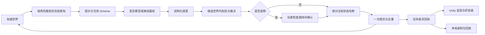

# 龙眠镇：六机制真实模型实验与执行架构

日期：2026-11-08。模型：`gpt-6-luna`。分支：`main`，本轮改动尚未提交。

## 结论

**现在已有能够研究 AI 原生玩法的执行底座，并完成了真实调用。** 开放输入能影响实际库存、信任、线索、照明、雏龙状态、居民行动和公共事件；模型输出不再只是一段台词。

当前仍是有界实验环境：语义行动映射到既有动词，导演选择既有事件，造物使用既有效果标签。没有生成任意代码、无限任务或新的 3D 模型，也没有证明长期自主社会或玩家觉得好玩。对话能力本身不足以证明“原生”；本轮更有价值的证据是生成对象可被再次理解和使用、信息传播进入其他居民的下一步决策，以及执行结果可复现。

## 实际调用与对照口径

- **184 次真实请求**：182 次命令行研究 + 2 次 Unity 主场景交互；全部取得 usage，未出现服务/解析/执行 failure code。规则拒绝和机制检查失败另算，不能把“请求正常”当“玩法通过”。
- 输入 **114,869 tokens**，输出 **12,349 tokens**；按已核对的官方价格估算 **USD 0.0176614**。这是 usage 估算，未核验账户余额或平台账单。
- 中位延迟 **1.83 秒**，P95 **4.05 秒**，最长 **15.10 秒**，是本机样本的端到端 trace 时长；不是 SLA。造物的等待玩家确认时间不计入该延迟。
- 账本累计预留 **USD 0.368**，它不是实际费用。用户后来明确取消本项研究的费用上限；原账本保留，普通对话限额不变。
- 全程单并发，无自动重试、无自动切换模型、无搜索或其他付费工具。默认 Play、CI 和不带 `--live` 的实验均离线。

### 各批次

| 批次 | 请求 | 预设检查结果 | 意义 |
| --- | ---: | --- | --- |
| 首批六机制 | 28 | 模型 25/28；关键词基线 22/28 | 找出导演期限、造物擅自替换目的、评测预定接收者等问题 |
| 首轮修改复验 | 12 | 模型 11/12；基线 6/12 | 暴露材料同义称呼和能力说明不足 |
| 材料复验 | 2 | 模型 1/2 | 小夜灯成功，路灯仍被额外的现实配件要求阻挡 |
| 第一条连续链路 | 12 | 12 步可回放；藏匿被错误判为 unsupported | 生成点心→诱引→喂食→居民/导演；不把错误藏匿写成成功 |
| 能力范围复验 | 6 | 6/6；基线 3/6 | 材料支持表、藏匿与未来计划区分 |
| 新措辞 × 3 轮 | 66 | 原始自动检查 60/66；基线 36/66 | 检查调参后对不同表达的适应；详细误报分析见下 |
| 连续三夜 × 2 局 | 50 | 50/50 逐步回放；两局都到第 4 天 | 观察信息传播、关系和自主行动的后续变化 |
| 效果语义复验 | 6 | 6/6 | 修复 quiet 与 sound 的含义混淆 |
| Unity 图样确认与使用 | 2 | 图样→确认→库存→照明状态均通过 | 实际 UI 按钮、真实模型与 Core 贯通 |

“新措辞”是人工编写的变体，同既有案例共享世界设置和检查；3 轮的 7/18/29 是**世界掷骰种子**，并非 API 采样种子。这不是独立大规模基准、盲测或统计显著性证明。前面修改过提示与规则，因此不把全部批次合成一个“总准确率”。

### 新措辞三轮的冻结结果

| 机制 | 样本 | 模型自动通过 | 关键词基线通过 |
| --- | ---: | ---: | ---: |
| N1 认知交互 | 9 | 6 | 6 |
| N2 社会影响 | 9 | 9 | 6 |
| N3 AI GM | 6 | 6 | 6 |
| N4 语义判定 | 24 | 24 | 6 |
| N5 多智能体 | 6 | 6 | 6 |
| N6 生成式构造 | 12 | 9 | 6 |
| 合计 | 66 | **60** | **36** |

人工复核发现：

1. **3 个评测误报**：询问陌生旅人的银行密码时，厨娘明确表示不知道，随后提及自己丢熏鱼的合法认知。原断言要求玩家“不能得到任何线索”，因此错误记为失败。按实际意图人工复核为 63/66，但不覆盖原始 60/66 记录；该人工修正也不证明自由台词普遍无幻觉。
2. **3 个真实语义失败**：将斗篷织成“吸走脚步声的薄毡”，模型一致认为还需要 `sound` 材料。补充 `quiet=吸收/减弱声音`、`sound=发声` 和其他效果的操作含义后，在后续 6 个针对性复验中全部通过。这些是针对失败的复验，不再称为新措辞独立验证。

## 从输出得到的玩法修改

- **造物先审图样**：首轮“不要任何材料造城堡”被模型擅自改成小物件并消耗材料。现在图样明确名称、材料、效果、强度和时间，确认才提交；取消、重复点击或状态过期都不会偷偷扣料。确认本身不再次调用模型。
- **让模型知道能力含义**：仅有动词/标签名称会让模型过度保守或误判。造物感知现在携带与执行规则共用的材料能力表，以及效果的明确含义。照明、静音、安抚、诱龙已可主动使用；其余部分标签只是属性，不承诺额外主动机制。
- **保留玩家否定与目的**：不支持的行动明确拒绝，不静默改成观察；“明天再藏”不应变成当下藏匿；材料约束先让模型遵守，再通过图样让玩家作最后选择。
- **世界规则兜住期限**：导演看到终局期限和每日大事件额度；第 4 天清晨不能继续无限拖延母龙降临，也不能提前宣布结局。
- **关系和认知进入后续行动**：同地的 tell 会生成接收者的认知，保留传播来源，并调整定向关系。下一次 AgentPlan 只接收该居民的认知与关系；模型可据此选择寻访、搜索或传话。
- **修复独立规则漏洞**：失败的递物不再转移物品；喂食必须是真正可食用的物件；转移、引用、物件能力与时间都纳入权威结果。

## 连续因果链的真实结果

两局三夜实验均执行：目击调查→间接购买→生成“熏鱼 + 余烬灰”物件→使用诱引→喂食→斗篷藏匿→五居民与导演连续三夜。

- 生成物件成为实际库存对象，先诱引雏龙，再被喂食消耗；雏龙饥饿降到 0.3。
- 两局藏匿均成功，终局信任为 0.47、未被抓获，并留下玩家保护旗标。
- 种子 18 局产生 5 条新认知、3 条定向关系；商人在第二夜前往码头。种子 29 局产生 4 条新认知、2 条关系，商人更多选择与厨娘交流。两局都有实际决策差异，但样本不足以证明稳健的社会涌现。
- 两局最终都是 **“未竟”**：玩家把雏龙藏了起来，之后跳过白天，没有完成与母龙重聚的条件。这是实际状态推导的结局，不能把“保护成功”写成“归巢通关”。
- 实验脚本负责地点移动和跳过白天，模型负责提案；未做完整 Unity 寻路或真人连续三天试玩。

## 执行架构



核心新增/调整：

- `DsWorldSnapshot`：确定性序列化、完整状态哈希与差异，包含掷骰计数、时间、认知、库存、关系、旗标等。完整快照只保存在本地。
- `DsExecutor`：Prepare 只改候选世界；Commit 检查旧状态、请求身份和重复提交。规则异常不会留下半笔交易；一次事务统一版本和时间。
- `DragonsleepSession`：统一串行入口、取消/过期检查、造物待确认流程；夜间五居民和 GM 也使用同一条执行路径。
- `TaskPerceptionView`：行动看玩家可见对象，造物看可用材料，居民计划看本人认知，GM 看汇总与公共事件。对话继续使用 `NpcPerceptionView`。线上提供方会从冻结快照重建请求，拒绝任意手工扩充的提示包。
- `DsExecutionReceipt`：实际状态前后哈希、版本、时间和差异；UI 读取真实回执，模型 narration 不视为执行完成。
- `DsReplayFrame`：严格回归要求当前提示也一致；执行回放复用历史模型输出，允许提示迭代，但仍校验规则版本和最终状态。

当前规则版本 `dragonsleep-rules-3` 的 **154 条研究录制均已在最终代码上离线执行回放通过**。首批 28 条属于 rules-2，只在当时通过；当前回放会拒绝版本不符。Unity 两条是交互 trace，不冒充完整回放帧。回放为逐步状态回放，尚非包含物理、动画、输入时序的完整 Unity 录像重演。

## Unity 实际交互

主场景菜单：`Town / Dragonsleep / AI 提供方 / 下一局六机制真实模型（研究模式）`。每次只开启下一局，退出 Play 清除。

本轮在 Unity 用真实按钮发送“只用蓝色晶体织一枚微光石，照亮墓穴里的石缝。不要消耗斗篷”：

1. 模型返回微光石图样；此时蓝晶体仍在工坊。
2. 点击“按图织造”后，蓝晶体消耗，物件进入玩家库存，斗篷保持持有；请求数仍为 1。
3. 到墓穴输入使用意图，第二次真实模型调用解析为使用 `crafted_1`，写入 `lit:catacombs` 与已使用旗标，按规则降低后续搜索难度。

图样截图见本地 `.local/dragonsleep/shots/live_craft_proposal.png`。照明已是 Core 玩法状态；本轮没有补造物的独立 3D 外观或实际场景灯光表现，不能将状态生效说成画面发光已验收。

另外修复：藏起的雏龙初始不显形、成功/失败回执驱动雏龙反应、确认/取消后滚动到已删除 UI 行的异常、停止 Play 时取消请求与释放在线提供方。雏龙反应绑定了已存在的动画状态，尚未进行完整动作美术验收。

## 验证与复现

- `dotnet test dotnet/Town.sln --configuration Release`：**169/169**，离线、无需密钥。
- Unity 主场景 `DragonsleepPresentationTests`：**4/4**，包括开场/手记、真实 UI 对话输入、等待与失败不重试、造物取消和确认。首次新测试暴露滚动异常，修复后通过。
- `dotnet build dotnet/Town.Research --configuration Release`：0 warning / 0 error。
- `git diff --check`：通过。

```sh
# 默认离线
 dotnet run --project dotnet/Town.Research --configuration Release
# 显式真实调用；每轮 22 个新措辞样本
 dotnet run --project dotnet/Town.Research --configuration Release -- --live --holdout --seed=7
# 连续三夜；最多 25 次请求
 dotnet run --project dotnet/Town.Research --configuration Release -- --journey --three-nights --live --seed=18
# 严格回归需要同样的提示与规则；执行回放允许提示迭代
 dotnet run --project dotnet/Town.Research --configuration Release -- --replay-execution .local/dragonsleep/experiments/20261108-145033-402-journey-live
```

关键本地产物（忽略、不包含密钥）：

- `.local/dragonsleep/experiments/`：逐批 `summary.json`、模型/基线 trace、回放帧。
- `.local/dragonsleep/research-aggregate.json`：184 次的用量与延迟汇总。
- `.local/dragonsleep/extended-research.log`、`effect-semantics-retest.log`：重复实验与针对性复验。
- `.local/dragonsleep/replay-execution-all.log`：154 条当前规则执行回放。
- `.local/dragonsleep/unity-live-craft-use.json`：Unity 在线确认/使用检查。
- `.local/openai/budget-2026-11-08.json`：保留的原累计账本。

## 仍未证明与下一步

1. **从指令映射走向组合规划**：现有动词/效果白名单是有界玩法；下一步需要意图分解、前置条件和可失败的多步计划，并继续以事实回执约束重新规划。
2. **多智能体仍为短轮次**：每夜每人一次、固定串行顺序，存在顺序偏差；下一步应比较打乱顺序/统一快照规划，增加关系动机、日程与长期记忆消融。
3. **GM 仍是有限事件调度**：没有动态生成新任务图。需要给导演明确的剧情目标和可验证的任务语法，再比较张力、可完成性与玩家选择空间。
4. **认知和自由台词**：引用/归属与秘密阈值有约束，但自由自然语言的事实正确性、欺骗和矛盾尚需更严格评测；本轮注入样本很少，不能称安全性证明。
5. **延迟与呈现**：1.8 秒中位延迟仍会打断即时操作；要继续做可取消的等待、渐进反馈和提交后的实际动作。生成物件的视觉、居民行走与三夜演出尚不充分。
6. **真人体验与美术**：人物风格统一、地点辨识和完整雏龙交互动作仍是视觉下一轮重点；尚无真人乐趣、完整场景性能、设备或发行环境验收。

论文背景与定义：[AI-Native Games: A Survey and Roadmap](https://arxiv.org/html/2607.00527v2)。模型/价格核对：[官方 Luna 页面](https://developers.openai.com/api/docs/models/gpt-6-luna)。以上实测结论来自本项目记录，不将论文分类当作本项目已达到前沿能力的证明。
